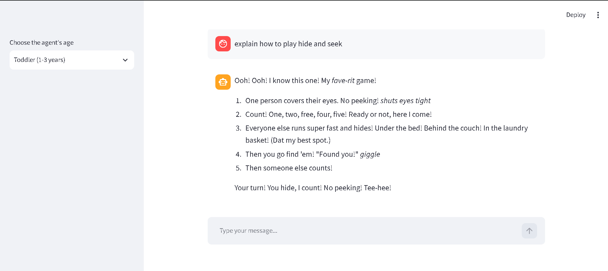
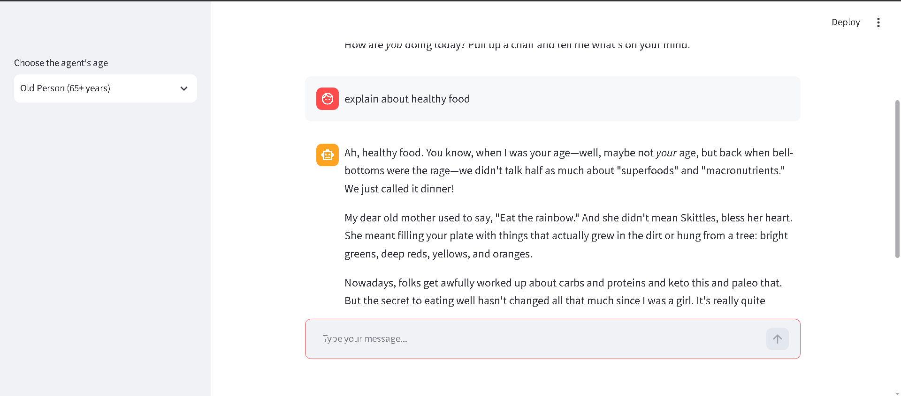

# AgeWise AI

AgeWise AI is a Streamlit chatbot that uses Google Gemini to answer questions in the style of a selected age group. Choose a personality from the sidebar and chat with an assistant that adapts its vocabulary, tone, humor, and perspective.

## Screenshots

Add application screenshots to `assets/screenshots/` and update the image path below:





## Features

- Age-based chatbot personalities, from infant to older adult
- Simple Streamlit chat interface
- Conversation history maintained during the current session
- Google Gemini responses through LangChain
- Dynamic system prompts that update when the selected age changes

## Requirements

- Python 3.10 or later
- A Google Gemini API key

## Installation

From the project root:

```bash
pip install -r requirements.txt
```

Create a `.env` file in the project root and add your Google API key:

```env
GOOGLE_API_KEY=your_google_api_key
```

Keep the `.env` file private and do not commit it to source control.

## Run the application

From the project root, run:

```bash
streamlit run chatmodels/chatbot_streamlit.py
```

The application will open in your browser. Select an age group from the sidebar, enter a message, and start chatting.

## How it works

The application creates a system prompt based on the selected age group. Each user message and generated response is stored in Streamlit session state and sent to the Gemini model as conversation history.

The application uses the `gemini-3.5-flash-lite` model through `ChatGoogleGenerativeAI`.

## Project file

- `chatbot_streamlit.py` - Main Streamlit application

## Notes

The chatbot's age-based behavior is for roleplay and entertainment. Responses should still be reviewed for accuracy, especially for important or sensitive topics.
